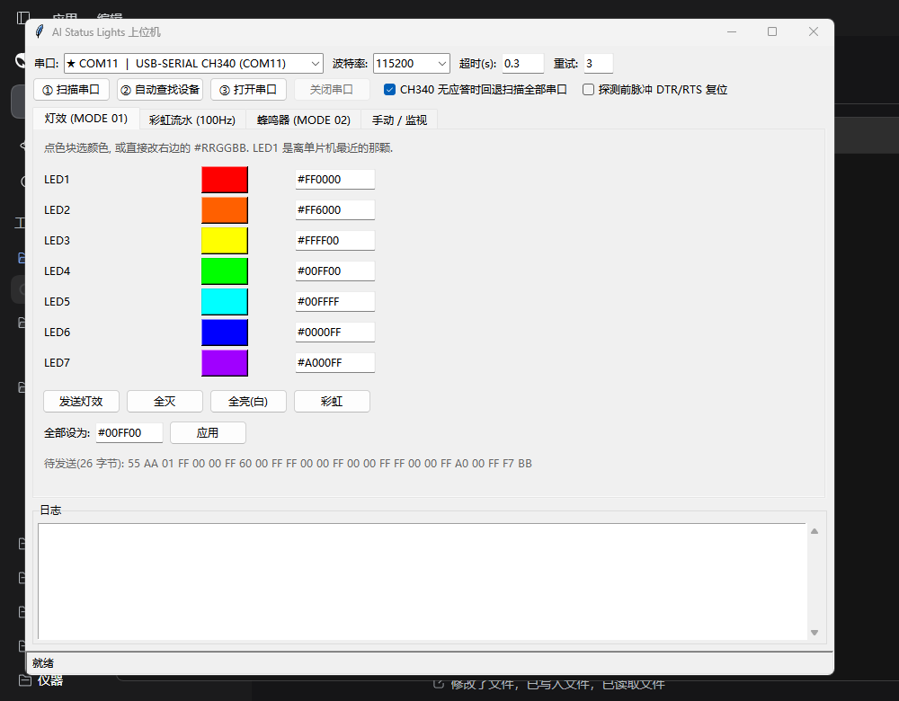
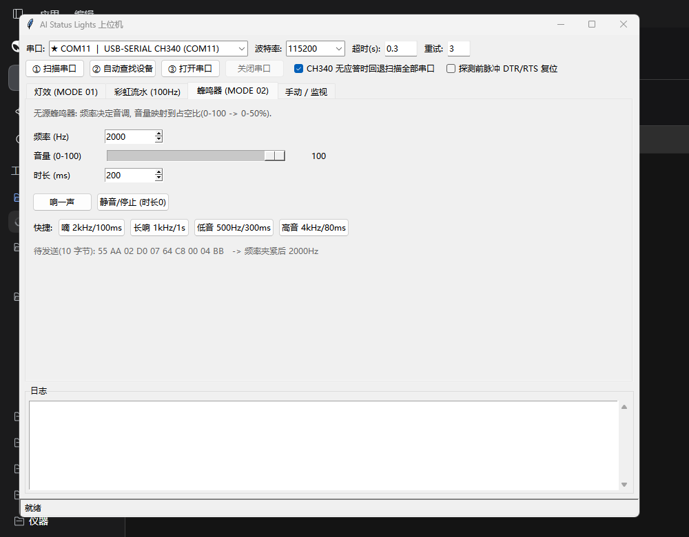
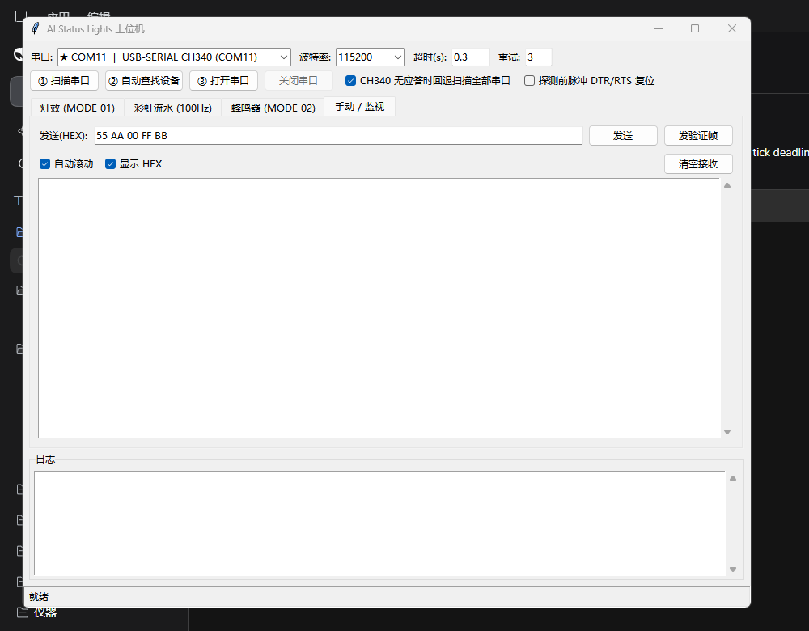
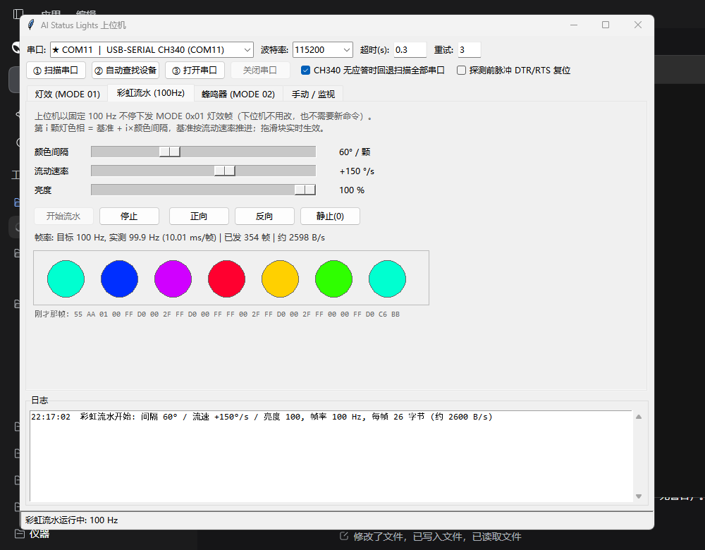

# AI Status Lights 上位机 (Python)

配套下位机: `../User/` 里的 CH32V003F4P6 固件。上位机分两部分:

| 文件 | 作用 |
| --- | --- |
| `ai_status_lights_gui.py` | 主程序。图形界面 + 命令行两种用法 |
| `ail_protocol.py` | 协议打包/解包(纯逻辑, 不依赖串口) |
| `ail_link.py` | 串口发现: 挑 CH340 → 逐个发验证帧 → 谁应答谁是板子 |
| `ail_rainbow.py` | **彩虹流水**: 颜色数学 + 100 Hz 流式发送线程 |
| `test_host_tools.py` | 离线自测, 用假串口跑真实源码, 不需要板子 |

依赖只有一个: `pip install pyserial`(图形界面用 Python 自带 tkinter)。

## 快速开始

```
双击 运行.bat          # 或者: python ai_status_lights_gui.py
```

打开后的三步步按钮, 顺序就是界面上的 ①②③:

1. **① 扫描串口** —— 列出所有串口, 描述里带 CH340/CH341 或用 1A86:7523 的标 `★` 并排在最前面;
2. **② 自动查找设备** —— 在 CH340 里逐个发验证帧 `55 AA 00 FF BB`, 收到 `AI Status Lights OK` 就是板子;
   第一个 CH340 装死就自动试下一个; 全都没应答而且勾了"回退扫描全部串口", 再扫其它串口;
3. **③ 打开串口** —— 连上(115200 8-N-1), 然后就能发灯效/蜂鸣/手动帧了。

串口号、波特率、探测超时和重试次数都可以手改; `探测前脉冲 DTR/RTS 复位` 只在你板子上
DTR/RTS 接了复位电路时才有用, 默认关掉。

## 界面



- **灯效 (MODE 01)**: 7 行, 点色块弹出取色器, 也可以直接敲 `#RRGGBB`; 下面一行实时显示
  将要发出去的 26 字节。按钮有 发送灯效 / 全灭 / 全亮 / 彩虹(与固件开机自检同一组颜色)。
- **彩虹流水 (100 Hz)**: 见下一节。
- **蜂鸣器 (MODE 02)**: 频率(20–20000 Hz)、音量(0–100)、时长(0–60000 ms), 有 4 个快捷档位。
  `静音/停止` 就是发一个"音量 0、时长 0"的帧。
- **手动 / 监视**: 直接发任意 HEX; `发验证帧` 一键填好验证帧; 下面是带时间戳的接收区
  (HEX 或 ASCII 可切), 收到的数据同时按协议尝试解析, 解析出来的帧会写进日志。
- **日志**: 探测过程的每一句(打开了哪个口、发了什么、回了什么)都在这儿。





## 彩虹流水(100 Hz, 纯上位机)



**下位机不用改**, 也**不需要新协议**: 上位机就用原来的 MODE `0x01` 静态灯效帧, 以固定的
100 Hz 不停地下发, 每帧把色相往前推一点, 看起来就是彩虹在流动。

```
第 i 颗灯色相 = (基准 + i × 颜色间隔) mod 360      i = 0..6
基准每秒推进 `流动速率` 度(可为负 = 反向)
每颗灯满饱和, 通道值再乘 `亮度`(0–100 -> 0–255), 与 MCU 的 8 位/通道一致
```

- **颜色间隔** 滑块 0–180°: 相邻两颗灯的色相差。60° 就是经典七色彩虹, 小间隔是渐变带。
- **流动速率** 滑块 −720…+720 °/s: 图案推进快慢; 0 = 图案静止, 负 = 方向相反。
  另有 `正向 / 反向 / 静止(0)` 三个按钮。
- **亮度** 滑块 0–100: 直接缩放 RGB 通道值(50 就是通道减半)。
- 三个滑块**拖动即时生效**, 动画不中断、色相不跳变(参数在主线程写入, 发送线程读快照)。
- 预览画布 7 个圆点是**真实要发出去的颜色**(就是当前帧的内容), 下面还显示"刚才那帧"的十六进制;
  状态行给出**实测帧率**, 例如 `目标 100 Hz, 实测 99.9 Hz (10.01 ms/帧) | 已发 354 帧 | 约 2598 B/s`。

### 帧率是怎么保证的

- 帧节奏走**绝对期限**(`perf_counter` 累积): 每帧的下一期限 = 上一期限 + 10 ms, 单帧被系统
  挤晚不会让后面的帧整体后移, 所以**平均帧率恒定 100 Hz、不累积漂移**;
- 色相推进用**实测经过的时间**, 所以流速只跟真实时间有关, 与写串口耗时无关;
- 进入流水时调用 Windows `timeBeginPeriod(1)`, 把系统定时器精度从 ~15.6 ms 提到 1 ms
  (退出时还原), 避免出现"睡过头"的锯齿;
- 本机实测 (2 秒窗口): **201 帧 / 100.00 Hz / 平均间隔 10.000 ms**。

### 其它

- 带宽: 26 字节 × 100 Hz = **2600 B/s**, 115200 的链路(约 11520 B/s)占用约 23%, 绰绰有余。
- 用 `开始流水` 启动; `停止` 会让灯停在最后一帧。在"灯效"页点 `发送灯效` 也会先自动停掉流水。
- 串口一旦关闭或连不上, 发送线程连续失败 5 次后自己停下并在日志/状态栏报原因, 不会刷屏。
- 因为动画由 PC 生成: **PC 卡住或程序退出, 灯就停在最后一帧**; 这是"上位机实现"的固有取舍
  (要 MCU 自己动起来就得改固件加新模式)。

## 命令行(适合脚本/批处理)

```
python ai_status_lights_gui.py --scan                       # 只列串口
python ai_status_lights_gui.py --find                       # 自动查找板子(退出码 0=找到)
python ai_status_lights_gui.py --port COM11 --verify        # 发验证帧
python ai_status_lights_gui.py --port COM11 --leds FF0000,FF6000,FFFF00,00FF00,00FFFF,0000FF,A000FF
python ai_status_lights_gui.py --port COM11 --leds-all 00FF00
python ai_status_lights_gui.py --port COM11 --beep 2000 100 500     # 频率 音量 时长ms
python ai_status_lights_gui.py --port COM11 --rainbow 40 120 100 --duration 10   # 间隔 流速 亮度 + 秒数
python ai_status_lights_gui.py --port COM11 --monitor 10            # 单纯监视 10 秒
```

`--rainbow` 每秒打印一次实测帧率, 例如:

```
彩虹流水: 间隔 40° / 流速 +120°/s / 亮度 100 | 帧率 100 Hz | 跑 5.0 秒 (每帧 26 字节, 约 2600 B/s)
  已发   102 帧, 实测 100.0 Hz (10.00 ms/帧)
```

不写 `--port` 时, 除了 `--scan`, 其它命令都会先自动查找一遍。

## 协议(与固件 `User/protocol.h` 一致)

```
55 AA | MODE | PAYLOAD... | CHECKSUM | BB
CHECKSUM = 从 0x55 起累加到 payload 最后一个字节, 取低 8 位
```

| MODE | payload | 整帧长度 | 固件动作 |
| --- | --- | --- | --- |
| `0x00` | 无 | 5 | 回 `"AI Status Lights OK\r\n"` |
| `0x01` | 21 字节 `R0G0B0 … R6G6B6` | 26 | 立即刷新 7 颗灯 |
| `0x02` | `频率(2,小端) 音量(1) 时长ms(2,小端)` | 10 | 非阻塞响一声 |

LE1 是离单片机最近的那颗灯; 线上颜色顺序是 RGB, 驱动器自己转成 WS2812B 的 GRB。

现成帧:

```
验证       55 AA 00 FF BB
7 灯全红    55 AA 01 FF 00 00 FF 00 00 FF 00 00 FF 00 00 FF 00 00 FF 00 00 FF 00 00 F9 BB
彩虹       55 AA 01 FF 00 00 FF 60 00 FF FF 00 00 FF 00 00 FF FF 00 00 FF A0 00 FF F7 BB
蜂鸣 2kHz/100/500ms   55 AA 02 D0 07 64 F4 01 31 BB
蜂鸣 1kHz/80/1000ms   55 AA 02 E8 03 50 E8 03 27 BB
```

## 自测

```
python test_host_tools.py
```

用假串口 + 虚拟板子跑**真实的上位机源码**, 不需要硬件, 覆盖 125 项检查:

- 三种帧的字节与上面列出的示例逐个字节一致(包括 GUI"彩虹"按钮产出的帧);
- 参数夹紧(频率/时长 16 位、音量 0–100)、非法颜色/HEX 解析报错;
- 解析器: 校验错、帧尾错、未知模式、`55 55` 重同步、半截帧 20 ms 超时丢弃;
- CH340 识别: 描述关键字 / VID:PID / WCH-Link 和 CP2102 不算 CH340; 串口号自然排序;
- 自动查找: 第一个 CH340 装死→选第二个; 命中即停(不碰其它口); CH340 全死→回退;
  关掉回退就不回退; 只有非协议响应→作为候选返回; 开机残留的旧应答不算命中;
- 打开失败的提示(端口被占用 / 能打开但没人应答);
- **彩虹流水颜色**: 亮度 0–100→0–255、六个纯色/负色相/360° 回绕、60° 间隔彩虹、
  色相走满一圈等价、亮度 0 全黑、参数夹紧、整帧仍是合法 MODE `0x01`;
- **彩虹流水 100 Hz**: 用假发送回调卡时间戳, 断言 0.6 秒的实测帧率(97–103 Hz)、
  平均帧间隔 10 ms、单帧偏差有界(不累积漂移)、每一帧都能被协议解析为 MODE `0x01`、
  颜色随时间流动、流速 0 静止、运行中改参数立即生效、亮度 0 全黑、
  连续发送失败后自动停止并报出原因;
- GUI 冒烟: 真建一遍窗口, 演练所有按钮处理函数、灯效预览、**彩虹页滑块→参数→预览联动**、
  未开串口时开始流水被拦住。

## 已知情况

- 上位机的校验和是**累加和低 8 位**, 与固件一致; 若你改了固件的校验算法, 这里要同步改
  `ail_protocol.checksum()`。
- 探测会给每个 CH340 串口发 5 个字节。CH340 上挂的如果不是本板子, 这点数据一般无害。
- 如果串口打不开(报 `PermissionError / 拒绝访问`), 基本是 MounRiver 的串口监视器、
  串口助手之类的程序还占着口, 关掉再试; 程序会把这种情况直接写在日志和提示里。
- 板子没烧录固件时, 自动查找的结果就是"找不到", 这是正常的。
- 彩虹流水是**上位机**生成的: 它只是把 MODE `0x01` 帧按 100 Hz 发下去, 所以
  **下位机固件一个字都没改**(重新构建后 Flash 6588 B / RAM 848 B, 与之前一致)。
  代价是 PC 不在、卡住或退出时, 灯就停在最后一帧。
- 100 Hz 说的是**发送**节奏(平均 10.000 ms/帧, 不累积漂移); 单个帧偶尔被 Windows 调度
  挤晚 1–4 ms 是正常的, 肉眼看不出。USB 串口本身还有 ~1 ms 的转发延迟。
